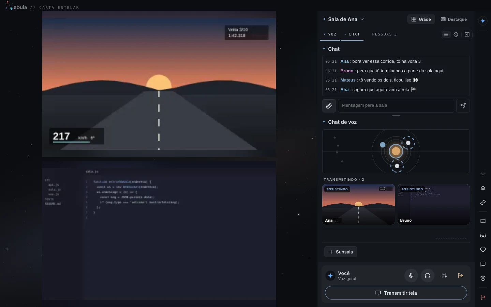
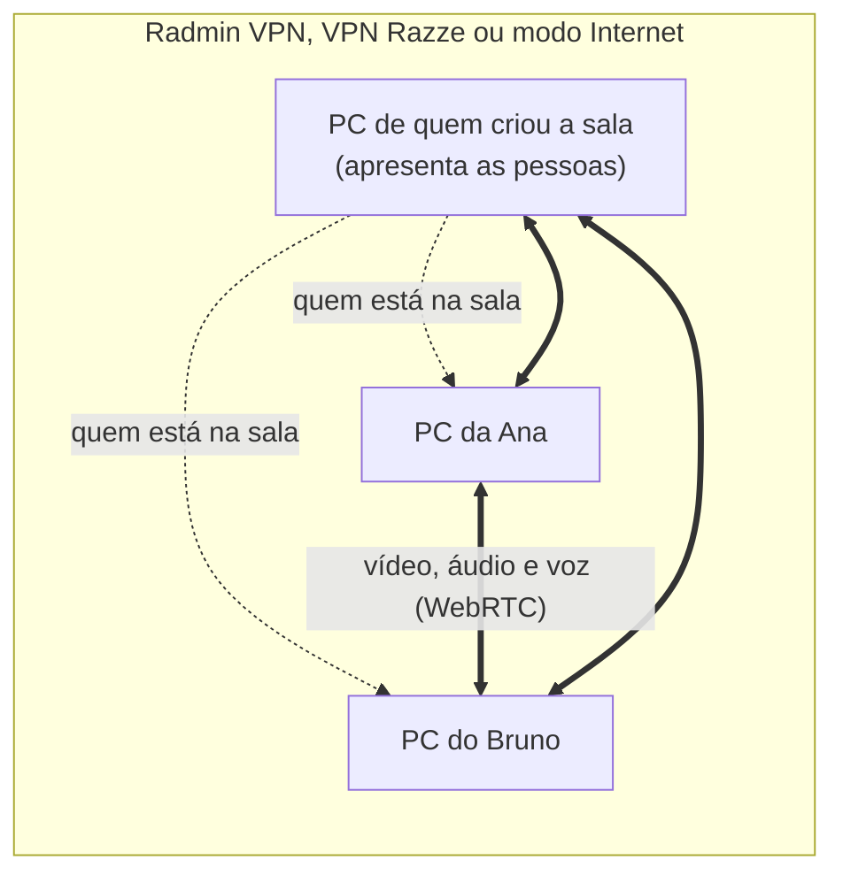
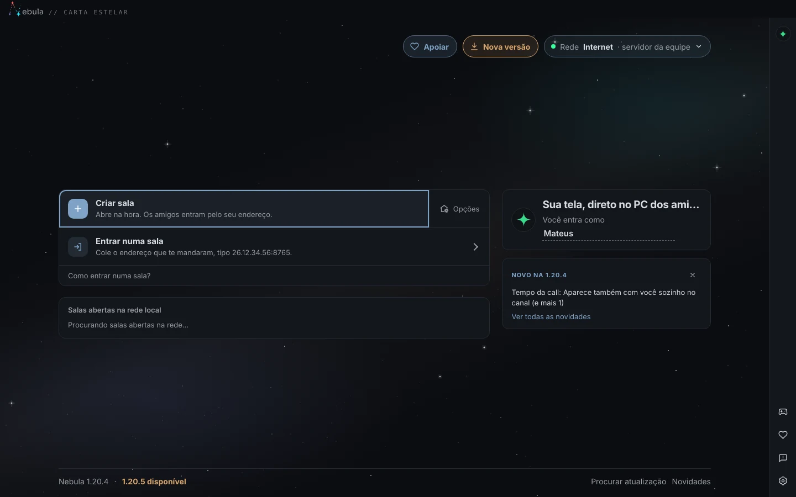
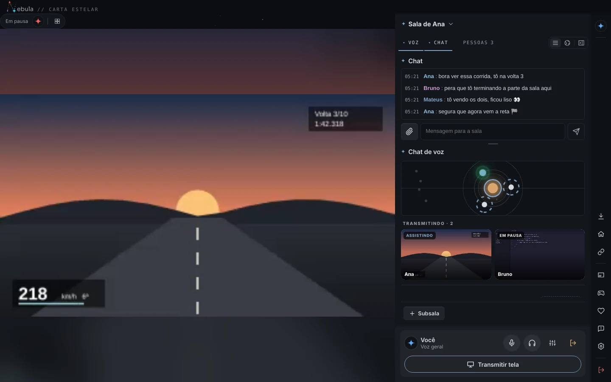
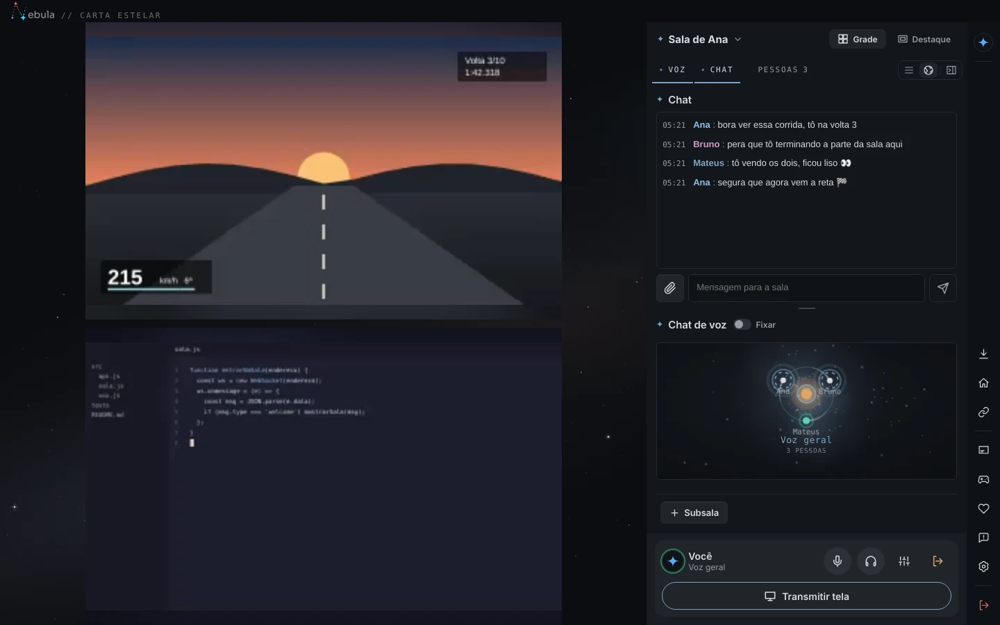
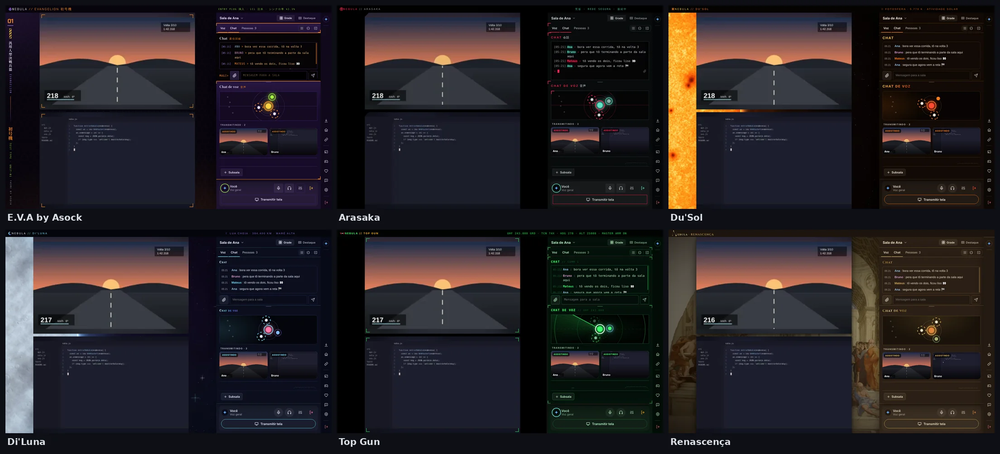
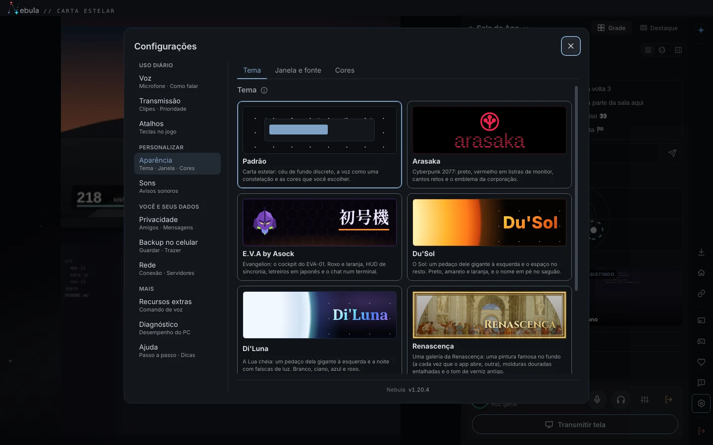

<p align="center">
  
</p>

<h1 align="center">Nebula</h1>

<p align="center">
  <b>Transmita a tela e converse por voz com os amigos, direto de um PC para o outro.</b><br>
  Sem servidor pago, sem limite de qualidade de plano, feito para rodar junto com o jogo.
</p>

<p align="center">
  <a href="https://github.com/MateusMunhoz/AmostradinhoScreenShare/releases/latest"><b>Baixar a versão mais nova</b></a>
  &nbsp;·&nbsp; <a href="docs/guia.md">Guia de uso</a>
  &nbsp;·&nbsp; <a href="#problemas-comuns">Problemas comuns</a>
</p>

<p align="center">
  
</p>

Antes chamado **Tela P2P**: quem já usa continua com as configurações, o histórico e os convites de antes ([o que mudou](docs/spec/nebula.md)).

## O que é

O Nebula é um app para Windows (e Linux) para assistir junto: cada um transmite a própria tela, todo mundo vê todo mundo e conversa por voz e chat, como numa call do Discord, mas com a imagem indo direto de um PC para o outro.

- **Várias telas ao mesmo tempo**, com o som do PC, em até 4K (ou 1080p a 60 fps).
- **Voz com supressão de ruído por IA**, apertar para falar e volume por pessoa.
- **Feito para quem joga:** janelas flutuantes por cima do jogo, chat sem sair do jogo e um modo gamer que deixa o app leve.
- **A sala não cai quando o host sai:** outra pessoa assume sozinha.
- **Temas completos**, que mudam o app inteiro, não só as cores.

## Como funciona



1. Os PCs ficam na mesma rede: pela **Radmin VPN** (grátis), pela **VPN WireGuard Razze** ou pelo **modo Internet**, sem VPN, com um servidor numa VPS.
2. Uma pessoa cria a sala. O app dela vira o ponto de encontro: só apresenta quem está na sala.
3. Depois de apresentadas, as pessoas se conectam **direto**, por WebRTC. O vídeo, o áudio e a voz não passam por nenhum servidor, então não há mensalidade nem limite de qualidade imposto por terceiros. No modo Internet, quando a rede de alguém não deixa a conexão direta (CGNAT, 4G), o vídeo passa pelo TURN da VPS, sempre criptografado de ponta a ponta.

## Por dentro do app

### Tela inicial

Criar uma sala, entrar numa sala pelo endereço ou clicar numa das salas abertas na sua rede. O app avisa quando sai versão nova e atualiza com um clique.

<p align="center"></p>

### Transmitir e assistir

Várias pessoas transmitem ao mesmo tempo. Na **Grade**, todas as telas aparecem lado a lado; no **Destaque**, uma fica grande e as outras numa coluna ao lado. Dá para trocar a tela ou a janela no meio da transmissão sem parar, deixar o som do Discord de fora e abrir qualquer tela numa **janela flutuante** por cima do jogo, com o clique passando direto.

<p align="center"></p>

### Chat e voz

- **Chat** com arquivos de até 200 MB. Também tem uma versão por cima do jogo: **Ctrl+Enter** escreve sem sair dele.
- **Voz** com supressão de ruído por IA, cancelamento de eco, ouvir a própria voz para testar o microfone, apertar para falar, volume de cada pessoa e indicador de quem está falando.
- **Subsalas**, cada uma com o seu canal de voz.
- **Mapa da voz:** cada canal vira um sistema solar, e quem está nele aparece como planeta.
- **Música junto (YouTube):** cole o link no canal de voz e quem clicar em Ouvir escuta no mesmo ponto. A sala sincroniza tocar, pausar, pular e trocar.

<p align="center"></p>

### Temas

A aba **Tema** muda o desenho do app inteiro: fundo, bordas, fontes, sons e até o jeito do chat e da voz. Além do Padrão, vêm prontos o Arasaka, o E.V.A by Asock, o Du'Sol, o Di'Luna, a Renascença, o Top Gun e o Cloud.

<p align="center"></p>

### Configurações

Aparência em Opaco, Transparente ou Líquido (vidro no estilo do iOS; no Windows 11 a área de trabalho aparece desfocada atrás do app), temas de cores, quatro cores por hexadecimal, luz ambiente nos vídeos, fonte da interface (incluindo as instaladas no PC), sons de cada evento com prévia e volume, atalhos e desempenho. Tudo fica salvo no PC.

<p align="center"></p>

## Baixar

Pegue o arquivo da versão mais nova em [Releases](https://github.com/MateusMunhoz/AmostradinhoScreenShare/releases/latest). Depois disso, o próprio app avisa quando sair uma versão nova, e um botão atualiza. As atualizações são assinadas: o app só instala o que foi publicado pela equipe.

| Sistema | Arquivo | Como é |
|---|---|---|
| Windows, instalado | `Nebula.Instalador.exe` | Instala só para você (sem pedir administrador) ou para todos do PC, cria atalhos e aparece em Aplicativos instalados. Desinstalar não apaga as configurações nem o histórico das mensagens. |
| Windows, portátil | `Nebula.exe` | Não instala nada: é só abrir (pode ficar num pendrive). |
| Linux (Ubuntu, Mint, com X11) | `Tela-P2P.AppImage` | Veja [Linux](#linux). |

## Começar

1. **Radmin VPN (todos):** instale a [Radmin VPN](https://www.radmin-vpn.com). Uma pessoa cria a rede (Rede > Criar rede) e passa o nome e a senha. Os outros entram nela. Cada um fica com um IP que começa com 26.
2. **Criar a sala (uma pessoa):** abra o app, confira no topo que a **Rede** está na Radmin (clique para trocar), digite seu nome e clique em **Criar sala**. Mande para os amigos o endereço que aparece (tipo `26.12.34.56:8765`).
3. **Entrar (os outros):** a sala aparece em **Salas abertas na Radmin**, na tela inicial: clique em **Entrar**. Se não aparecer, clique em **Entrar numa sala**, cole o endereço e clique em **Entrar**.
4. **Firewall:** na primeira vez, o Windows pergunta se o app pode acessar a rede. Marque **redes privadas e públicas** e permita, em todos os PCs.

Detalhes de cada coisa no [Guia de uso](docs/guia.md).

## Linux

O app funciona no Ubuntu e no Mint (sessão X11). Da primeira vez, no terminal:

```
sudo apt install libfuse2t64 wireguard-tools xinput pkexec
chmod +x Tela-P2P.AppImage
./Tela-P2P.AppImage
```

No Ubuntu 22.04 e no Mint 21, troque `libfuse2t64` por `libfuse2`. O `wireguard-tools` e o `pkexec` são para a VPN Razze; o `xinput`, para o apertar para falar.

<details>
<summary>O que muda em relação ao Windows</summary>

- **Radmin:** não existe no Linux. Pela internet, use a VPN Razze (ou a rede local).
- **Som do PC na transmissão:** vai o som inteiro do PC (pelo PulseAudio ou PipeWire), inclusive o das telas que você assiste. Não dá para deixar apps de fora, e com a voz ligada a tela vai sem som (senão a voz da call iria junto).
- **Codificação:** sempre pela do navegador (o NVENC direto é só do Windows).
- **VPN Razze:** o túnel é do próprio Linux. Ao conectar, o sistema pede a sua senha uma vez. Ele não volta sozinho depois de reiniciar o PC: clique em **Conectar** de novo.
- **Apertar para falar:** precisa de sessão X11 (no Wayland, o sistema não deixa ler a tecla com o app fora de foco).

</details>

## Problemas comuns

| Problema | O que fazer |
| --- | --- |
| "Não foi possível conectar" | Confira se a Radmin está ligada nos dois PCs e se o endereço está certo. Teste com um ping no IP 26.x. |
| Conecta, mas o vídeo não aparece | Libere o app no Firewall do Windows (redes públicas) nos dois PCs. |
| "A porta já está em uso" | Troque a porta (ex.: 8766) e passe o endereço novo. |
| Sem áudio na transmissão | Veja se há som tocando no dispositivo de saída padrão do Windows. |
| A voz do Discord aparece na transmissão | Marque o Discord em "Ignorar o som destes apps", na tela de transmitir. |
| "Não foi possível ignorar os apps escolhidos" | Confira a versão do Windows (precisa do 10 versão 2004 ou mais novo) e se o antivírus não bloqueou o `audiocap.exe`. |
| O microfone não funciona na voz | Permita o microfone para aplicativos de desktop nas configurações de privacidade do Windows. |
| O jogo perde FPS enquanto transmito | Use 720p 60 fps (ou 30 fps), transmita a janela do jogo e experimente "Uma vez só para todos". Veja [Desempenho](docs/desempenho.md). |
| A janela flutuante ou o chat não aparecem por cima do jogo | Coloque o jogo em modo janela sem bordas (tela cheia exclusiva fica por cima de tudo). |
| Borda amarela em volta da transmissão (Windows 10) | Já resolvido. Se alguma janela de jogo sair preta, transmita a Tela inteira. |

## Documentação

| Para | Leia |
|------|------|
| Usar tudo (sala, transmitir, janelas flutuantes, chat, voz, atalhos, estatísticas) | [docs/guia.md](docs/guia.md) |
| Jogar e transmitir sem pesar (qualidade, NVENC, tela cheia, Windows 10) | [docs/desempenho.md](docs/desempenho.md) |
| Mexer no código, testar e publicar | [docs/desenvolvimento.md](docs/desenvolvimento.md) |
| Trabalhar em equipe com o Claude Code (issue, spec, PR, CI, versão nova) | [docs/fluxo-com-ia.md](docs/fluxo-com-ia.md) |
| Testar numa call com gente de verdade | [docs/roteiro-de-teste.md](docs/roteiro-de-teste.md) |
| RazzeAPI, VPN WireGuard e implantação numa VPS | [docs/razze-api.md](docs/razze-api.md) |
| Modo Internet (sem VPN: salas por código + senha, STUN e TURN numa VPS) | [servidor-internet/README.md](servidor-internet/README.md) |
| O que vem por aí e como fazer (Discord e TeamSpeak como referência) | [docs/roadmap.md](docs/roadmap.md) |

## Feito com

Electron, WebRTC e Node.js na interface e nas conexões; C++ nos ajudantes nativos do Windows (captura de áudio por app, captura de vídeo com NVENC e teclas globais); Node.js, Docker e WireGuard na RazzeAPI.

<sub>As imagens deste README são de uma sala de teste com três cópias do app conectadas de verdade. As transmissões mostram vídeos de exemplo desenhados para os prints.</sub>
